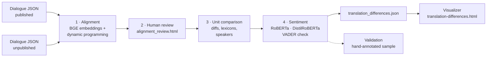

# Translation Differences

### *Two English translations of one German vampire tale, compared line by line*

**Karl von Wachsmann, „Der Fremde" (1844)**
*The Mysterious Stranger* (published translation, 1854) &nbsp;·&nbsp; *The Stranger* (unpublished translation)

[Visualizer](https://horrordigitalhumanities.org) &nbsp;·&nbsp; [Vampirul pipeline](https://github.com/andricolae/vampirul-network-analysis) &nbsp;·&nbsp; [Cite](#-citation)

---

## What it does

Given the dialogue of two translations of the same text, the pipeline:

1. **pairs** every line of one translation with its counterpart in the other,
2. lets a **human reviewer** confirm or correct every pair,
3. **compares** each pair: word changes, sentences found in one translation only, speakers and addressees, forms of address, religious, supernatural and archaic vocabulary, proper nouns, punctuation,
4. scores **polarity and emotion** on both sides and flags the lines where the tone shifts,

and exports a single JSON file that powers an interactive visualizer.

The algorithm proposes, measures and flags; the reader reviews, validates and interprets.

---

## The pipeline



| Step | What happens | Output |
|---|---|---|
| **1 · Alignment** | Each line is embedded with [`BAAI/bge-base-en-v1.5`](https://huggingface.co/BAAI/bge-base-en-v1.5). Similarity is calibrated so that 0 = *as alike as unrelated passages* and 1 = *same meaning*. Character names that differ between translations (e.g. *Kumpan* / *Tamek*) are masked. A monotonic dynamic-programming search pairs lines 1:1, 1:2, 2:1, or leaves a line unpaired. | `alignment_draft.json` |
| **2 · Human review** | A local review page shows every proposed unit; the reviewer confirms, splits, merges or unpairs it. Every save is checked: each line exactly once, in story order. | `alignment_reviewed.json` |
| **3 · Unit comparison** | Word-level diff, sentences without a counterpart (mutual best match), speaker and addressee changes, lexical flags, proper nouns, punctuation. Each unit is classed *near-identical*, *paraphrase*, *divergent* or *one-sided*. | `unit_differences.json` |
| **4 · Sentiment** | Polarity (−1 … +1) with [`cardiffnlp/twitter-roberta-base-sentiment-latest`](https://huggingface.co/cardiffnlp/twitter-roberta-base-sentiment-latest), seven emotions with [`j-hartmann/emotion-english-distilroberta-base`](https://huggingface.co/j-hartmann/emotion-english-distilroberta-base), a [VADER](https://github.com/cjhutto/vaderSentiment) cross-check. A shift is flagged when polarity moves by ≥ 0.3 or the emotion profiles differ by ≥ 0.15 (Jensen–Shannon divergence), and both sides have at least six words. | `translation_differences.json` |
| **Validation** | A stratified sample is exported for hand annotation; the notebook reports accuracy, Cohen's κ and confusion matrices. | `sentiment_validation_sample.csv` |

All thresholds live in one place (`DIFF_PARAMS` in the notebook) and are written into the output metadata, so every result can be traced back to the settings that produced it.

---

## Quick start

```bash
git clone https://github.com/andricolae/translation-diffs-pipeline.git
cd translation-diffs-pipeline

python -m venv .venv
# Windows: .venv\Scripts\activate    macOS / Linux: source .venv/bin/activate
pip install -r requirements.txt

jupyter lab translation_differences.ipynb
```

Run the notebook from top to bottom. The models download from Hugging Face on first use (≈ 1 GB, CPU is fine).

**The two stops for a human**

* After **step 1**, the notebook starts the review page at `http://localhost:5002`. Review the units, save, then continue.
* After **step 4**, fill in `your_polarity` and `your_emotion` in `translation_differences/sentiment_validation_sample.csv` and run the validation cell.

**Viewing the results**

Once the notebook has produced `translation_differences/translation_differences.json`, serve the repository folder and open the visualizer:

```bash
python -m http.server 8000
# then open http://localhost:8000/translation-differences.html
```

The page looks for `translation_differences/translation_differences.json`. To publish it as a single static page instead, paste the exported data in an inline script before the page script:

```html
<script>window.TD_DATA = /* contents of translation_differences.json */;</script>
```

---

## Repository layout

```
translation-diffs-pipeline/
├── README.md
├── requirements.txt
├── LICENSE
├── translation_differences.ipynb      ← the pipeline (steps 1–4 + validation)
├── alignment_review.html              ← step 2 review interface
├── translation-differences.html       ← the visualizer
└── style.css                          ← shared site stylesheet
```

The repository contains the **code only**: no texts, annotations or results are distributed. To reproduce the analysis, place your own two dialogue files next to the notebook (by default `dialogue_the_mysterious_stranger.json` and `dialogue_the_stranger.json`) or set their paths in the first configuration cell. The notebook creates the `translation_differences/` output folder (character crosswalk, alignment draft, reviewed alignment, unit differences, sentiment cache, validation sample, final JSON) as it runs.

**Input format.** Each dialogue file is the export of the [Vampirul pipeline](https://github.com/andricolae/vampirul-network-analysis) (dialogue extraction → human validation → character assignment): a `dialogues` list whose items carry `id`, `current_text`, `speaker_name`, `dialogue_partner`, `silent_participants` and `status`. A crosswalk in the notebook links the two casts, so that the same character is recognised under different names.

---

## Models and methods

* Xiao et al., *C-Pack: Packaged Resources To Advance General Chinese Embedding* (BGE)
* Loureiro et al., *TimeLMs: Diachronic Language Models from Twitter* (Twitter-RoBERTa)
* Hartmann, *Emotion English DistilRoBERTa-base*
* Hutto and Gilbert, *VADER: A Parsimonious Rule-Based Model for Sentiment Analysis of Social Media Text*
* Lin, *Divergence Measures Based on the Shannon Entropy* (Jensen–Shannon divergence)
* Cohen, *A Coefficient of Agreement for Nominal Scales* (κ)

---

## Citation

If you use this pipeline, please cite:

> Martin-Căluțiu, Andrei-Nicolae, and Anca Simina Martin. *Translation Differences: a human-in-the-loop pipeline for comparing literary translations.* GitHub, 2026, github.com/andricolae/translation-diffs-pipeline.

---

Made in Sibiu with 🩸 by **Andrei-Nicolae Martin-Căluțiu** & **Anca Simina Martin**
Part of [Undead Networks · horrordigitalhumanities.org](https://horrordigitalhumanities.org)